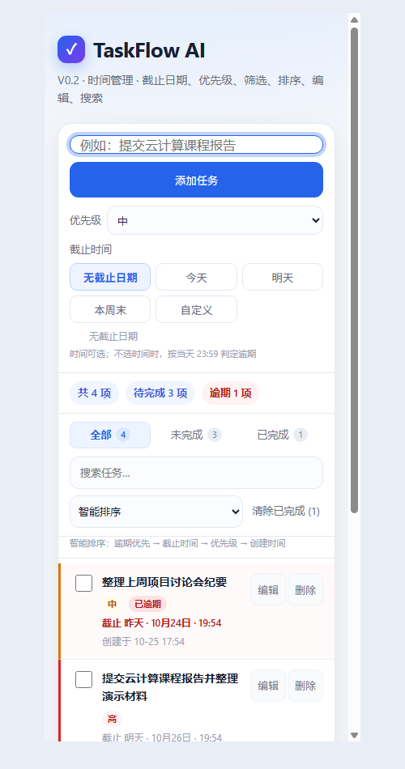

# TaskFlow AI

面向碎片化信息的任务收集与时间管理应用。课程项目分三个 Feature 并行开发：

- **Feature 1 · 云端数据管理**：登录、CloudBase 数据库、CRUD、跨设备同步、用户隔离；
- **Feature 2 · AI 智能信息提取**：聊天/通知/网页文字 → 待办/日程/备忘；
- **Feature 3 · 可视化与分析**：日历、Dashboard、时间线。

当前 `index.html` 是已可运行的 V0.2.1 基线，后续 Feature 在独立目录开发，通过 `window.TaskFlow` 接入。

## 线上地址

```text
https://bumpy-damselfly-d5fm66ql428df3c9-1516532038.tcloudbaseapp.com/
```

CloudBase 测试默认域名首次访问会有「页面访问提示」，点「确定访问」进入。环境 ID：

```text
bumpy-damselfly-d5fm66ql428df3c9
```

## 当前基线功能

- 添加 / 完成 / 删除 / 清除已完成
- 截止日期：无 / 今天 / 明天 / 本周末 / 自定义
- 自定义日期 + 可选时间；不选时间按当天 23:59
- 过去时间即时提示
- 优先级高 / 中 / 低
- 筛选、排序、搜索、编辑、逾期高亮
- `localStorage` 持久化 + V0.1 迁移
- 390px 手机布局
- `window.TaskFlow` 集成 API



## 快速开始

```powershell
# 任选一种
python -m http.server 8766 --directory .
# 或直接双击 index.html
```

打开 `http://127.0.0.1:8766/`。

没有构建步骤，没有 npm 依赖。

## 仓库结构

```text
.
├── index.html                 当前 V0.2.1 单文件应用
├── deploy.cmd                 CloudBase 静态部署
├── docs/
│   ├── PROJECT.md             项目定位、架构、Feature 边界
│   ├── HTML-LOGIC.md          当前 HTML/JS 逻辑与扩展点
│   ├── DATA-CONTRACTS.md      任务/AI/统计/云 API 数据契约
│   ├── FEATURE-1-CLOUD.md     Feature 1 要求与云操作
│   ├── FEATURE-2-AI.md        Feature 2 要求与本地开发
│   ├── FEATURE-3-VISUALIZATION.md
│   ├── TEAM-WORKFLOW.md       Git/PR/部署/权限
│   ├── CLOUD-SETUP.md         CloudBase 配置步骤
│   ├── ACCEPTANCE.md          验收清单
│   └── DELIVERY-TEMPLATE.md   交付模板
├── src/
│   ├── shared/task.schema.json
│   ├── cloud/README.md        Feature 1 目录
│   ├── ai/README.md           Feature 2 目录
│   └── visualization/README.md
├── mock/
│   ├── tasks.json             12 条任务
│   ├── ai-input.json          示例聊天文本
│   ├── ai-output.json         期望结构化结果
│   └── analytics.json         Dashboard 数据形状
└── screenshots/
```

## 三个 Feature 的入口

- [Feature 1 · 云端数据管理](docs/FEATURE-1-CLOUD.md)
- [Feature 2 · AI 信息提取](docs/FEATURE-2-AI.md)
- [Feature 3 · 可视化与分析](docs/FEATURE-3-VISUALIZATION.md)

协作规则、分支、部署、云权限见 [TEAM-WORKFLOW.md](docs/TEAM-WORKFLOW.md)。

## 集成 API

页面加载后提供：

```js
window.TaskFlow = {
  version: "0.2.1",
  getTasks(),                 // Task[]
  getStorageKey(),            // "taskflow.v2.tasks"
  subscribe(listener),        // 立即回调 + 变化回调，返回 unsubscribe
  replaceTasks(nextTasks),    // 整体替换（云端同步）
  addTasks(nextTasks),        // 批量追加（AI 确认）
};
```

- Feature 2 确认后调用 `addTasks()`；
- Feature 3 用 `getTasks()` / `subscribe()`；
- Feature 1 负责把本地实现替换/桥接为云端；
- 不要直接改页面私有变量。

## 数据契约

任务对象、云 API、AI JSON、统计口径都在 [DATA-CONTRACTS.md](docs/DATA-CONTRACTS.md)。Schema：

- `src/shared/task.schema.json`
- `src/ai/extraction.schema.json`

## 部署

先安装 CloudBase CLI：

```powershell
npm install -g @cloudbase/cli
tcb login
```

然后：

```powershell
.\deploy.cmd
```

只上传 `index.html`，不会上传 docs/mock/截图。

## 验收

V0.2.1 基线：

- 日期/移动端专项 18/18；
- `TaskFlow` API 测试通过；
- 线上文件与本地哈希一致。

完整清单见 [ACCEPTANCE.md](docs/ACCEPTANCE.md)。

## 安全

- 不提交 `.env`、API Key、数据库密码、CloudBase 登录态；
- AI Key 只在本地 `.env` 或云函数环境变量；
- 不提交真实聊天记录、手机号、邮箱；
- 数据库用户/密钥最小权限，离职/结束后轮换。

## 下一步

1. 创建 Git 私有仓库并 push；
2. 三个 Feature 按各自文档开分支；
3. Feature 1 先做登录/数据库，Feature 2/3 先用 Mock；
4. 项目负责人按周合并、部署、验收。
