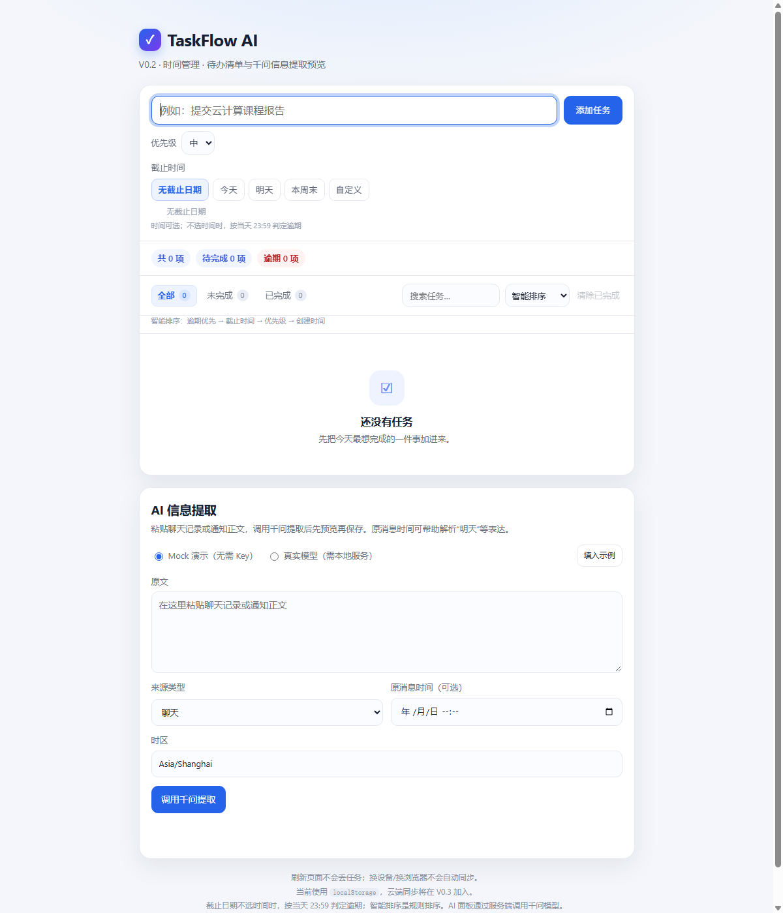

# Feature 2 · 千问信息提取

本目录包含输入/预览/确认界面、`POST /api/extract` 接口、JSON Schema + Pydantic 校验、100 条合成标注样本和评测脚本。模型固定为 `qwen3.8-flash`，密钥由服务端环境变量 `BDCCP_API` 提供。

页面有两种模式：

- **Mock 演示（默认）**：不需要服务/Key，点「填入示例」→「调用千问提取」即可走完预览/确认流程；公网静态部署也能用。
- **真实模型**：需要本地 FastAPI 服务和 `BDCCP_API`。



## 本地运行

### Mock 演示

```powershell
python -m http.server 8766
```

打开 `http://127.0.0.1:8766/`，AI 模式保持「Mock 演示」，点「填入示例」。

### 真实模型（Windows）

```powershell
$env:BDCCP_API = "你的百炼 Key"
.\run-ai.cmd
```

或手动：

```powershell
python -m pip install -r src/ai/server/requirements.txt
python -m uvicorn src.ai.server.app:app --host 127.0.0.1 --port 8766
```

打开 `http://127.0.0.1:8766/`，把 AI 模式切到「真实模型」，粘贴聊天记录或通知正文，按需要填写来源时间和时区，点击「调用千问提取」→ 编辑/勾选候选 →「确认保存选中项」。来源类型为 `chat`（聊天）和 `notice`（通知）。

> 真实模型接口当前仅允许本机访问；公网部署前需接入登录、限流和云函数/云托管。

## 接口与密钥

接口请求格式见 `docs/FEATURE-2-AI.md`。同一个 FastAPI 服务提供静态页面和 `/api/extract`。服务端使用百炼 OpenAI 兼容接口调用 `qwen3.8-flash` 的非思考模式及严格 JSON Schema 输出；默认使用北京地域 DashScope 地址。若密钥属于其他地域或专属业务空间，设置 `QWEN_BASE_URL` 为该地域 OpenAI 兼容 Base URL。

接口检查输入长度、来源类型、带时区时间、IANA 时区；输出通过 JSON Schema、Pydantic 和证据原文子串校验。模型生成的地点、负责人、时间表达式若不在原文中，会被清空并标记待核对。空响应或非法输出重试一次。错误格式为 `{ "error": { "code": "...", "message": "..." } }`。密钥不会传到前端或写入日志。真实模型接口当前仅允许本机访问，公网部署前需由负责人接入登录与限流。

## 保存方式与合并接口

确认时，仅选中项被映射为当前 `TaskFlow.addTasks()` 可接收的 Task。`event` 在清单中以 `[日程]` 标识，使用 `start_at` 投影到现有 `dueAt`；`note` 以 `[备忘]` 标识。完整候选字段、原文和证据另存本地 `taskflow.ai.sources.v1`，以 `taskId` 关联；AI 面板底部可以展开查看。该来源记录暂未跨设备同步，合并云端数据模型时由负责人迁移。

## 校验与评测

```powershell
python -m unittest src.ai.server.test_app -v
python -m src.ai.eval.evaluate
```

第二条仅审计 100 条标注数据。启动本地服务后，运行真实模型评测：

```powershell
python -m src.ai.eval.evaluate --url http://127.0.0.1:8766/api/extract --concurrency 4 --save-predictions src/ai/eval/predictions-qwen3.8-flash.json
```

评测脚本只有在 100 条预测全部成功且通过校验时才输出 Precision、Recall、F1、字段准确率和来源字段无依据率。样本由 20 个手写场景模式各生成 5 个主题/人名/地点变体，为**合成测试集**；结果和已知漏检见 `docs/AI-EVAL.md`。上线前仍需用脱敏的真实场景样本做独立评测。
